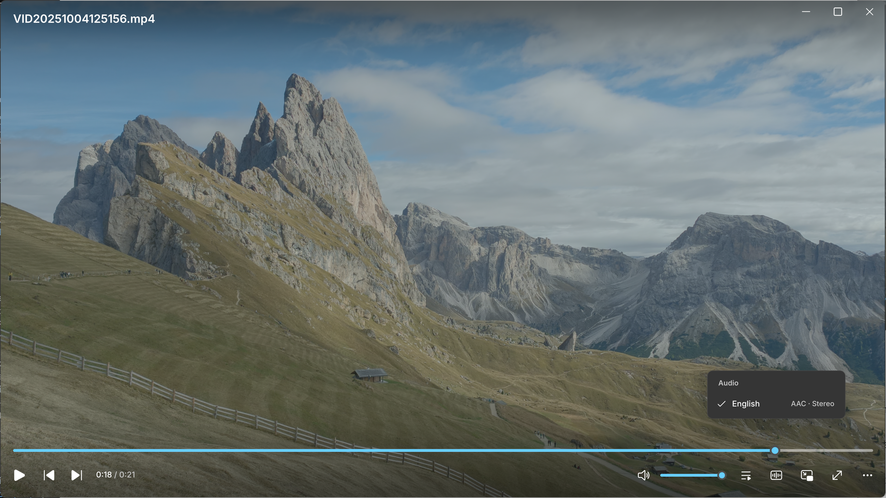
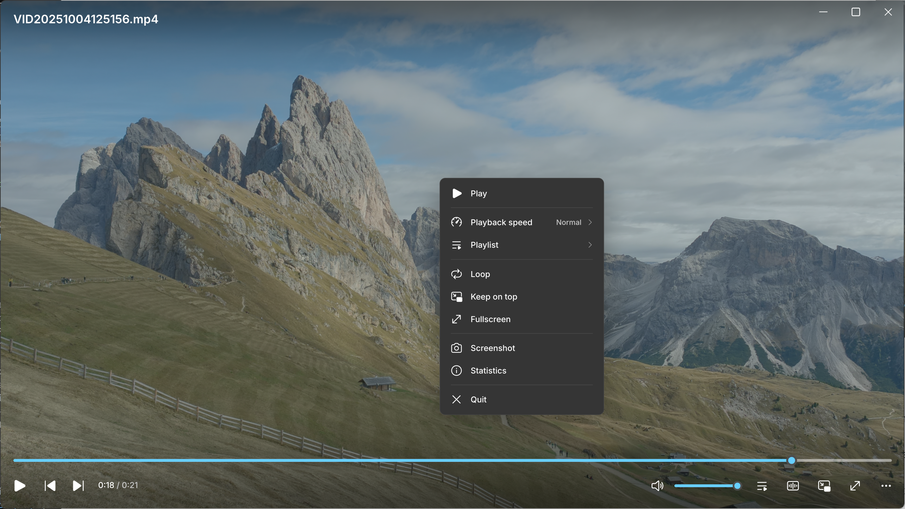

# Screenbox_Style

[中文](#chinese) | [English](#english)

---

<a id="chinese"></a>

## 中文说明

**Screenbox_Style** 是一套为原版 [mpv](https://mpv.io/) 打造的现代 Fluent 风格 OSC（On-Screen Controller）主题，以 Windows 现代媒体播放器 [Screenbox](https://github.com/stinus-dev/Screenbox) 的视觉设计与 UI 布局为蓝本，兼具轻量、流畅与开箱即用的体验。

> **免责声明**：本项目是受 Screenbox 视觉风格启发的第三方非官方 mpv 主题，与 Screenbox 官方团队无隶属关系。






### 主要特性

- **原汁原味的 Screenbox 视觉**：采用全宽顶栏与底栏布局、平滑无色阶断层的线性渐变遮罩，以及深色不透明弹出菜单。
- **同步平滑交互**：顶栏显示当前播放文件名（在无边框或全屏模式下自动呈现窗口三键），顶栏与底栏同步淡入淡出。
- **完整的底栏控制**：集成播放/暂停、上一个/下一个、进度条与时间显示、静音按钮与音量滑块（拖动时实时显示百分比气泡提示）。
- **实用功能入口**：内置文件夹播放列表（Folder Playlist）、独立的字幕/音频轨切换按钮、窗口置顶（Pin Window）、全屏切换，以及一键呼出 mpv 右键菜单（Context Menu）。
- **开箱即用**：内置 Inter UI 字体与多语言支持，默认优化了 OSD 位置与显示，减少与顶栏标题的重叠干扰。

### 快速安装

1. **获取并复制主题文件**  
   从本仓库源码或 Releases 压缩包中提取 `scripts/`、`script-opts/` 和 `fonts/` 三个文件夹，复制到你的 mpv 配置目录：
   - **Windows**：`%APPDATA%\mpv\`（若使用便携版，则为 mpv 程序目录下的 `portable_config\`）
   - **Linux / macOS**：`~/.config/mpv/`
2. **禁用 mpv 默认 OSC**  
   打开配置目录中的 `mpv.conf`，添加以下配置：
   ```ini
   osc=no
   ```
   > **提示**：如希望在窗口模式下也能体验无边框画面与顶栏窗口三键（Windows 11 下可自动配合系统原生圆角），可在 `mpv.conf` 中额外添加 `border=no`。
3. **重启 mpv** 即可生效。

### 推荐配置（`mpv.conf`）

为获得更佳的视觉流畅度与日常使用体验，建议按需在 `mpv.conf` 中加入以下选项：

- **高刷新率流畅渲染**  
  mpv 默认在播放视频时按视频自身帧率（如 24fps）提交画面与 OSC。若希望播放期间界面的淡入淡出、悬停与拖动也按显示器原生刷新率丝滑渲染，建议添加：
  ```ini
  video-sync=display-resample
  interpolation=yes
  tscale=oversample
  ```

### 自定义选项

你可以直接编辑 `script-opts/modernz.conf` 来调整主题的语言、字体大小、自动隐藏时长、按键显示等行为。常用项均带有注释说明。

### 目录结构

```text
Screenbox_Style/
├── assets/                                 # 预览截图与展示素材目录
├── fonts/                                  # Inter UI 字体与许可证（Inter-Medium.ttf, Inter-SemiBold.ttf）
├── script-opts/                            # 配置文件与多语言包（modernz.conf, modernz-locale.json）
├── scripts/                                # 核心 Lua 脚本（modernz.lua）
├── docs/                                   # 项目开发与设计文档（中英双语）
│   ├── PROJECT_OVERVIEW.md                 # 项目总览（项目目标、参考项目与版本规划）
│   └── REQUIREMENTS_ISSUES_PROGRESS.md     # 需求描述、问题记录与开发进度追踪
├── LICENSE                                 # GNU LGPL v2.1 开源许可证
└── README.md                               # 使用说明文档（本文件）
```

### 更多文档

- 项目目标、参考架构与版本规划，请参阅 **[docs/PROJECT_OVERVIEW.md](./docs/PROJECT_OVERVIEW.md)**。
- 详细需求、验收标准、已知问题与开发日志，请参阅 **[docs/REQUIREMENTS_ISSUES_PROGRESS.md](./docs/REQUIREMENTS_ISSUES_PROGRESS.md)**。

### 致谢与许可证

- **致谢**：
  - 视觉设计与 UI 布局参考自 [Screenbox](https://github.com/huynhsontung/Screenbox)
  - 核心脚本衍生并修改自 [ModernGlass](https://github.com/Demetter/ModernGlass) 与 [ModernZ](https://github.com/Samillion/ModernZ)（追溯自 `ModernX`、`mpv-osc-modern` 及 [mpv](https://mpv.io/) 官方 `osc.lua`）
  - 内置 UI 字体采用 [Inter](https://rsms.me/inter/)
- **许可证**：
  - 本项目脚本代码遵循 **[GNU Lesser General Public License v2.1 (LGPL-2.1)](./LICENSE)** 开源协议。
  - `fonts/` 目录下的 Inter 字体遵循 **SIL Open Font License 1.1**，详见 [fonts/Inter-LICENSE.txt](./fonts/Inter-LICENSE.txt)。

---

<a id="english"></a>

## English

**Screenbox_Style** is a modern Fluent-style OSC (On-Screen Controller) theme for vanilla [mpv](https://mpv.io/), modeled after the visual design and UI layout of the modern Windows media player [Screenbox](https://github.com/stinus-dev/Screenbox). It is designed to be cohesive, lightweight, smooth, and ready to use out of the box.

> **Disclaimer**: This is an unofficial third-party mpv theme inspired by Screenbox's design language and is not affiliated with the Screenbox project.


### Features

- **Authentic Screenbox Aesthetics**: Full-width top and bottom bars, smooth banding-free linear gradient scrims, and dark opaque popup menus.
- **Synchronized Fade Transitions**: Displays the current filename in the top bar (with window caption buttons in borderless or fullscreen mode), fading top and bottom bars in and out together.
- **Complete Bottom Controls**: Play/Pause, Previous/Next, seekbar with time display, mute button, and volume slider with a live percentage tooltip while dragging.
- **Built-in Utilities**: Folder Playlist, dedicated Subtitle and Audio track buttons, Pin Window (always-on-top), Fullscreen toggle, and one-click access to the native mpv Context Menu.
- **Ready Out of the Box**: Bundles Inter UI fonts and multi-language localization, with sensible OSD defaults to prevent overlapping the top bar title.

### Installation

1. **Copy theme files**  
   Extract the `scripts/`, `script-opts/`, and `fonts/` folders from this repository (or a Release archive) into your mpv configuration directory:
   - **Windows**: `%APPDATA%\mpv\` (or `portable_config\` inside your mpv directory for portable builds)
   - **Linux / macOS**: `~/.config/mpv/`
2. **Disable the default OSC**  
   Add the following line to your `mpv.conf`:
   ```ini
   osc=no
   ```
   > **Tip**: To use the built-in top-bar window controls in windowed mode (paired naturally with native rounded corners on Windows 11), you can also add `border=no` to `mpv.conf`.
3. **Restart mpv** and enjoy.

### Recommended Configuration (`mpv.conf`)

For the smoothest visual experience during daily playback, consider adding the following options to `mpv.conf`:

- **High-Refresh-Rate OSC Rendering**  
  By default, mpv presents both video and OSC at the video's native framerate (e.g., 24fps) during playback. To keep OSC animations, hover states, and seeking running smoothly at your display's native refresh rate, add:
  ```ini
  video-sync=display-resample
  interpolation=yes
  tscale=oversample
  ```

### Customization

Edit `script-opts/modernz.conf` to customize language, font sizes, auto-hide timeout, visible controls, and more. All options are documented inline.

### Directory Structure

```text
Screenbox_Style/
├── assets/                                 # Screenshots & visual showcase assets
├── fonts/                                  # Inter UI fonts & license (Inter-Medium.ttf, Inter-SemiBold.ttf)
├── script-opts/                            # Configuration & locales (modernz.conf, modernz-locale.json)
├── scripts/                                # Core Lua script (modernz.lua)
├── docs/                                   # Project documentation (bilingual)
│   ├── PROJECT_OVERVIEW.md                 # Project overview (goals, references & roadmap)
│   └── REQUIREMENTS_ISSUES_PROGRESS.md     # Requirements, issues & progress tracking
├── LICENSE                                 # GNU LGPL v2.1 License
└── README.md                               # User guide & installation (this file)
```

### Documentation

- For project goals, reference architecture, and release scope, see **[docs/PROJECT_OVERVIEW.md](./docs/PROJECT_OVERVIEW.md)**.
- For detailed requirements, acceptance criteria, issue tracking, and changelog, see **[docs/REQUIREMENTS_ISSUES_PROGRESS.md](./docs/REQUIREMENTS_ISSUES_PROGRESS.md)**.

### Credits & License

- **Credits**:
  - Visual design and UI layout inspired by [Screenbox](https://github.com/huynhsontung/Screenbox)
  - Core script derived from [ModernGlass](https://github.com/Demetter/ModernGlass) and [ModernZ](https://github.com/Samillion/ModernZ) (building on `ModernX`, `mpv-osc-modern`, and [mpv](https://mpv.io/)'s official `osc.lua`)
  - UI typography powered by [Inter](https://rsms.me/inter/)
- **License**:
  - Script code is licensed under the **[GNU Lesser General Public License v2.1 (LGPL-2.1)](./LICENSE)**.
  - The bundled Inter fonts in `fonts/` are licensed under the **SIL Open Font License 1.1** (see [fonts/Inter-LICENSE.txt](./fonts/Inter-LICENSE.txt)).
